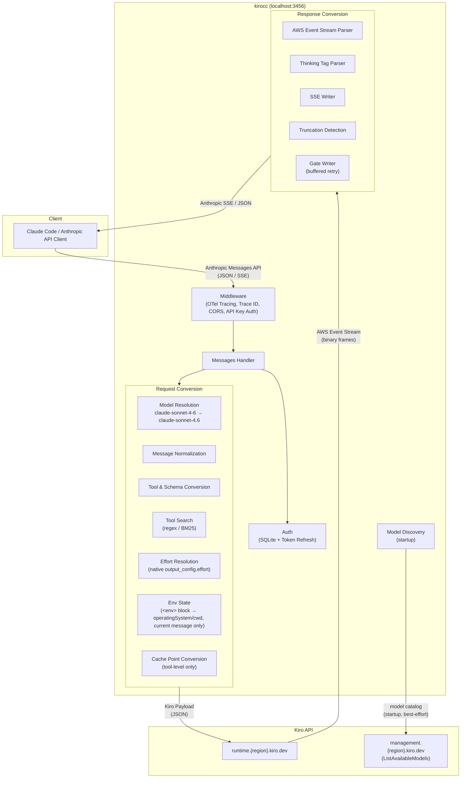

# kirocc

A local proxy server that relays Anthropic Messages API-compatible requests to the Kiro (Amazon Q) backend using Kiro CLI credentials.

Just set `ANTHROPIC_BASE_URL` from any Anthropic API client (e.g., Claude Code) to use Claude models via Kiro.

## Features

- **Anthropic Messages API compatible** — Supports `/v1/messages` (streaming / non-streaming), `/v1/messages/count_tokens`, and `/v1/models`
- **Request conversion** — Automatically converts Anthropic API requests to Kiro API (AWS Event Stream) format
- **Response conversion** — Converts Kiro event streams back to Anthropic SSE format
- **Automatic auth management** — Reads credentials from Kiro CLI's SQLite DB with automatic token refresh (Social / OIDC)
- **Kiro API key authentication** — Alternatively authenticate with a `KIRO_API_KEY` (`ksk_…`) for headless environments (CI, containers) where an interactive Kiro login is not available
- **Model mapping** — Maps Anthropic model names (e.g., `claude-sonnet-4-6`) to Kiro model names. Customizable via environment variable
- **Automatic model discovery** — Fetches Kiro's model catalog (`ListAvailableModels`) at startup, so models Kiro launches after a kirocc release resolve with the right context window and effort levels without a code change. Built-in mappings always win; discovery only fills gaps
- **Account usage reporting** — Logs the plan, credits used / limit / remaining, reset time, free-trial and bonus grants and per-model credit multipliers at startup; a running credit total per response; a per-model session summary on shutdown; and a clear `402 billing_error` (no retry) when the quota is exhausted. See [Account usage reporting](#account-usage-reporting)
- **Custom API region** — Pin the region in `runtime.<region>.kiro.dev` with `-kiro-api-region`, for accounts whose stored credential region is not one Kiro serves
- **Extended Thinking** — Enable via the `[1m]` suffix, the `thinking` field, or `output_config.effort`. Reasoning depth travels natively as `additionalModelRequestFields.output_config.effort` (validated against each model's enum; defaults to `medium` for effort-capable models when thinking is on without an explicit effort)
- **Tool Search** — Proxy-side implementation of Anthropic's [Tool Search Tool](https://platform.claude.com/docs/en/agents-and-tools/tool-use/tool-search-tool). Supports `tool_search_tool_regex_20251119` and `tool_search_tool_bm25_20251119` with `defer_loading` for on-demand tool discovery
- **Web Search** — Opt-in proxy-side implementation of Anthropic's [web search tool](https://platform.claude.com/docs/en/agents-and-tools/tool-use/web-search-tool) (`web_search_20250305`), which Claude Code's `WebSearch` uses. Kiro has no web search, so the search runs here against Brave, Tavily, Exa or your own endpoint (`-web-search-provider`). Without a provider a request carrying the tool is refused rather than answered without the search
- **Prompt Caching** — Converts Anthropic tool-level `cache_control` to Kiro `cachePoint`
- **Truncation detection** — Automatically injects a notice into the next request when a response is truncated
- **Retry** — Exponential backoff retry for 403 (token expiry), 429, and 5xx errors. Also retries thinking-only (empty visible) responses
- **API key auth** — Optional access restriction for the proxy itself
- **CORS** — Allows requests from localhost origins
- **File logging** — Write structured logs (OTel JSON Lines) to a rotating file via [lumberjack](https://github.com/natefinch/lumberjack). Defaults optimized for coding agent consumption (10 MB, uncompressed)
- **OpenTelemetry tracing** — Opt-in distributed tracing via `--otel` with OTLP HTTP exporter. Captures request/response headers and body as span events across the full proxy chain

## Prerequisites

- Go 1.27+
- One of the following:
  - [Kiro CLI](https://kiro.dev) installed and logged in, **or**
  - A Kiro API key (`KIRO_API_KEY`) — available for [Kiro Pro, Pro+, Pro Max, and Power](https://kiro.dev/docs/cli/authentication/) subscribers

## Installation

### Homebrew

```bash
brew install d-kuro/tap/kirocc
```

### go install

```bash
go install github.com/d-kuro/kirocc/cmd/kirocc@latest
```

## Usage

### Start the server

```bash
kirocc
```

Listens on `http://127.0.0.1:3456` by default.

### Use with Claude Code

```bash
export ANTHROPIC_BASE_URL=http://127.0.0.1:3456
export ANTHROPIC_AUTH_TOKEN=dummy
export CLAUDE_CODE_ENABLE_GATEWAY_MODEL_DISCOVERY=1   # optional: adds kirocc's models to the /model picker
claude
```

`ANTHROPIC_AUTH_TOKEN` is required by Claude Code but not used for authentication by kirocc (credentials are read from Kiro CLI's DB). Any non-empty value works unless `-api-key` is set.

`CLAUDE_CODE_ENABLE_GATEWAY_MODEL_DISCOVERY=1` makes Claude Code fetch `GET /v1/models` from kirocc and list the results in the `/model` picker under "From gateway" — including the "(1M context)" entries (see [1M context with Claude Code](#1m-context-with-claude-code)) and the GPT 5.6 models via their `claude-gpt-5.6-*` aliases (see [Model picker integration](#model-picker-integration-discovery-aliases)).

> [!IMPORTANT]
> For the 1M context window you must pick a "(1M context)" entry in `/model` — see [1M context with Claude Code](#1m-context-with-claude-code).

### Use with a Kiro API key

For headless environments (CI, containers, remote machines) where an interactive Kiro login is not available, you can authenticate with a [Kiro API key](https://kiro.dev/docs/cli/authentication/) instead:

```bash
export KIRO_API_KEY=ksk_...          # your Kiro API key
kirocc                               # no Kiro CLI login or database needed
```

When `KIRO_API_KEY` is set:

- The SQLite credential database is **never opened** — kirocc does not need Kiro CLI installed
- No token refresh occurs — the key is presented directly to the Kiro API
- A revoked key surfaces as a 401 from the API at request time
- An empty or unset key falls back to the credential database as before

Optionally set `KIRO_API_REGION` (default: `us-east-1`) if your Kiro account is in a different region.

Then use with Claude Code as usual:

```bash
export ANTHROPIC_BASE_URL=http://127.0.0.1:3456
export ANTHROPIC_AUTH_TOKEN=dummy
claude
```

API keys are available for Kiro Pro, Pro+, Pro Max, and Power subscribers. On group subscriptions, an administrator must enable key generation in _Settings → Kiro settings → Enable users to generate API keys_. Create keys at [app.kiro.dev](https://app.kiro.dev) → API Keys.

### Command-line options

| Flag                       | Default                   | Description                                                                                      |
| -------------------------- | ------------------------- | ------------------------------------------------------------------------------------------------ |
| `-port`                    | `3456`                    | Listen port                                                                                      |
| `-host`                    | `127.0.0.1`               | Bind host                                                                                        |
| `-db`                      | (OS-dependent, see below) | Kiro CLI SQLite DB path                                                                          |
| `-api-key`                 | (none)                    | API key required to access the proxy                                                             |
| `-kiro-api-key`            | (none)                    | Kiro API key (`ksk_…`) to use instead of the Kiro CLI DB credential                              |
| `-kiro-api-region`         | (credential's region)     | Region for Kiro API endpoints (`runtime.<region>.kiro.dev`)                                      |
| `-config`                  | `mejituu.json5` by binary | Path to the custom provider config (see [Custom providers](#custom-providers))                   |
| `-model-discovery`         | `true`                    | Fetch Kiro's model catalog at startup                                                            |
| `-keepalive-interval`      | `15s`                     | SSE idle keep-alive interval (0 = disabled)                                                      |
| `-promote-on-thinking`     | `true`                    | Let thinking deltas open the output gate early: reasoning streams progressively; thinking-only turns are no longer retried transparently |
| `-response-header-timeout` | `60s`                     | Max wait for Kiro response headers (0 = no limit, otherwise >= 1s)                               |
| `-web-search-provider`     | (none)                    | Run `web_search_20250305` proxy-side via `brave`, `tavily`, `exa` or `custom`; empty disables it |
| `-web-search-api-key`      | (none)                    | API key for the search provider                                                                  |
| `-web-search-url`          | (none)                    | Endpoint for `-web-search-provider custom`                                                       |
| `-web-search-max-results`  | `5`                       | Results per search                                                                               |
| `-debug`                   | `false`                   | Enable debug logging                                                                             |
| `-log-file`                | (none)                    | Write logs to file with rotation (file-only by default)                                          |
| `-log-max-size`            | `10`                      | Max log file size in MB before rotation                                                          |
| `-log-max-backups`         | `5`                       | Max number of old log files to retain                                                            |
| `-log-max-age`             | `7`                       | Max days to retain old log files                                                                 |
| `-log-compress`            | `false`                   | Compress rotated log files with gzip                                                             |
| `-log-console`             | `false`                   | Also write logs to console when `-log-file` is set                                               |
| `-otel`                    | `false`                   | Enable OpenTelemetry tracing (OTLP HTTP exporter)                                                |
| `-otel-body-limit`         | `32768`                   | Max bytes of request body to capture in OTel spans (0 = unlimited)                               |

#### Default DB path

| OS      | Path                                                  |
| ------- | ----------------------------------------------------- |
| macOS   | `~/Library/Application Support/kiro-cli/data.sqlite3` |
| Linux   | `~/.local/share/kiro-cli/data.sqlite3`                |
| Windows | `%LOCALAPPDATA%\kiro-cli\data.sqlite3`                |

### Environment variables

Command-line options can be overridden with environment variables.

| Variable                         | Corresponding option       |
| -------------------------------- | -------------------------- |
| `KIROCC_PORT`                    | `-port`                    |
| `KIROCC_HOST`                    | `-host`                    |
| `KIROCC_DB_PATH`                 | `-db`                      |
| `KIROCC_API_KEY`                 | `-api-key`                 |
| `KIRO_API_KEY`                   | `-kiro-api-key`            |
| `KIRO_API_REGION`                | `-kiro-api-region`         |
| `KIROCC_MODEL_DISCOVERY`         | `-model-discovery`         |
| `KIROCC_KEEPALIVE_INTERVAL`      | `-keepalive-interval`      |
| `KIROCC_PROMOTE_ON_THINKING`     | `-promote-on-thinking`     |
| `KIROCC_RESPONSE_HEADER_TIMEOUT` | `-response-header-timeout` |
| `KIROCC_WEB_SEARCH_PROVIDER`     | `-web-search-provider`     |
| `KIROCC_WEB_SEARCH_API_KEY`      | `-web-search-api-key`      |
| `KIROCC_WEB_SEARCH_URL`          | `-web-search-url`          |
| `KIROCC_WEB_SEARCH_MAX_RESULTS`  | `-web-search-max-results`  |
| `KIROCC_DEBUG`                   | `-debug`                   |
| `KIROCC_LOG_FILE`                | `-log-file`                |
| `KIROCC_LOG_MAX_SIZE`            | `-log-max-size`            |
| `KIROCC_LOG_MAX_BACKUPS`         | `-log-max-backups`         |
| `KIROCC_LOG_MAX_AGE`             | `-log-max-age`             |
| `KIROCC_LOG_COMPRESS`            | `-log-compress`            |
| `KIROCC_LOG_CONSOLE`             | `-log-console`             |
| `KIROCC_OTEL`                    | `-otel`                    |
| `KIROCC_OTEL_BODY_LIMIT`         | `-otel-body-limit`         |

`KIRO_API_KEY` and `KIRO_API_REGION` intentionally keep Kiro's own names rather than the `KIROCC_` prefix, so a machine already configured for headless kiro-cli needs no kirocc-specific setup.

### Custom API region

Kiro API endpoints are region-scoped: completions go to `runtime.<region>.kiro.dev` and the model catalog to `management.<region>.kiro.dev`. By default the region comes from the Kiro CLI credential (the profile ARN, or the region stored by kiro-cli).

That default is not always a region Kiro serves. kiro-cli records the region you signed in from, and only a few regions have Kiro hosts — `us-east-1`, `eu-central-1`, `us-gov-east-1`, `us-gov-west-1` at the time of writing. If your credential resolves to anything else, the hostname does not exist and every request fails with an upstream error. `-kiro-api-region` pins the region instead:

```bash
kirocc -kiro-api-region us-east-1
```

```
INFO Kiro API region pinned region=us-east-1
INFO credentials loaded auth_type=idc region=ap-southeast-1
```

The override applies to the API endpoints only. Token refresh still targets the region that issued the credential, since a token is rejected outside it.

### Automatic model discovery

At startup kirocc calls Kiro's `ListAvailableModels` and installs the result as a fallback layer behind the built-in mapping table. A model Kiro launches after a kirocc release therefore resolves with its real context window and effort enum instead of falling back to pass-through defaults, and shows up in `GET /v1/models`.

Resolution order is `KIROCC_MODEL_MAPPINGS` → built-in table → discovered catalog, first match wins. Built-ins deliberately win: they encode behaviour a mechanically derived entry cannot reproduce, such as which `[1m]` aliases must _not_ enable extended thinking and which SKU a 1M request routes to.

Discovery is best-effort and never blocks startup or fails a request. It is skipped when the credential has no profile ARN (which is the case for `-kiro-api-key` auth, since the API requires one), and any error leaves the built-in table in place:

```
WRN model discovery failed, using built-in model table region=ap-southeast-1 err="..."
```

Disable it with `-model-discovery=false`.

The same step logs each model's credit multiplier as advertised by the catalog:

```
INF model rates auto=1x claude-opus-4.7=2.2x claude-sonnet-4.6=1.3x claude-haiku-4.5=0.4x ...
```

### Account usage reporting

kirocc reports the Kiro account's credit position in its log, with no extra command or endpoint. It needs a credential with a profile ARN (Kiro CLI social or IDC login); with `-kiro-api-key` it reports only the process totals.

At startup, alongside model discovery, it calls `GetUsageLimits` on the same control plane (`management.<region>.kiro.dev`):

```
INF credentials loaded auth_type=idc region=us-east-1 profile_arn=arn:aws:codewhisperer:us-east-1:123456789012:profile/ABCD token_expires_at="2026-10-20 11:21:31"
INF usage plan="KIRO PRO+" used=1234.56 limit=2500 remaining=1265.44 used_pct=49.4% resets_at="2026-11-01 08:00:00" email=dev@example.com
INF usage breakdown kind=base used=1200 limit=2000
INF usage breakdown kind=free_trial status=ACTIVE used=34.56 limit=500 expires_at="2026-10-31 08:00:00"
INF usage breakdown kind=bonus status=EXPIRED used=0 limit=100
INF usage overage status=DISABLED overages=0
```

When the stored token had expired, the same account fields appear on the `token refreshed` line instead of `credentials loaded`. Either line also carries `sso_region` when the token was issued in a different region from the API region.

| Field | Meaning |
| --- | --- |
| `plan` | Subscription title |
| `email` | Account email, when upstream returns it |
| `used` / `limit` / `remaining` / `used_pct` | Credits this cycle, across the plan allowance plus active free-trial and bonus grants |
| `resets_at` | When the monthly allowance resets (local time) |
| `usage breakdown` | Per-component lines, logged only when the account has a free trial or bonuses; `expires_at` is when the free trial lapses |
| `usage overage` | Pay-as-you-go status and amount beyond the limit, when the account reports it |

Optional fields (`plan`, `email`, `used_pct`, `resets_at`, `expires_at`) are omitted when upstream does not return them.

Each response line that reports credits then carries the process running total and, when the startup query succeeded, an estimate of what is left (the startup `remaining` minus credits this process has spent since; usage from other clients on the same account is not reflected until kirocc restarts):

```
INF <-- POST /v1/messages ... credits=1.234 session_credits=15.678 remaining_est=1249.762
```

The response line also carries the request's latency: `ttft` (time to first token — from when kirocc received the request until the upstream first produced content: text, reasoning, or a tool call; retries count into it, but only the attempt the client actually receives contributes the first token), `tps` (output tokens per second over the generation span, from the first token to the end of the response; non-streaming provider responses report `tps_total`, output tokens per second over the whole request, instead), and `duration` (total time from request receipt to response completion, rounded to milliseconds). `ttft` and `tps` are omitted when they cannot be measured — no content arrived, fewer than two output tokens, or an upstream error.

On shutdown (SIGINT / `Ctrl+C` or SIGTERM), totals for the session, overall and per model, once any request has completed:

```
INF session usage requests=42 credits=123.456 input_tokens=812345 output_tokens=45678
INF session usage model=claude-opus-4.7 requests=30 credits=100.12 input_tokens=... output_tokens=...
```

When upstream refuses a request because the quota is exhausted (HTTP 402, or a throttling error naming `MONTHLY_REQUEST_COUNT` / `DAILY_REQUEST_COUNT`), kirocc does not retry it. It returns `402 billing_error` to the client (or a `billing_error` SSE event once a stream has started) and logs `WRN kiro quota exhausted`. When the startup query succeeded, the message names the plan and, unless the daily cap was hit, the reset time; a daily-cap refusal carries no reset time, since the reported reset date is the monthly one. A refusal triggers no further upstream call.

A failed usage query costs one `WRN usage query failed` line and nothing else.

### OpenTelemetry tracing

Enable distributed tracing to visualize the full request chain in Jaeger, Grafana Tempo, or any OTLP-compatible backend.

```bash
# Start a local collector (e.g., Grafana LGTM stack)
docker run -d --name lgtm -p 3000:3000 -p 4317:4317 -p 4318:4318 grafana/otel-lgtm

# Start kirocc with tracing enabled
kirocc -otel
```

The OTLP endpoint defaults to `http://localhost:4318` and can be configured via the standard `OTEL_EXPORTER_OTLP_ENDPOINT` environment variable.

### Custom model mappings

Use the `KIROCC_MODEL_MAPPINGS` environment variable to override model name mappings.

```bash
export KIROCC_MODEL_MAPPINGS='[{"anthropic":"my-model","kiro":"claude-sonnet-4.5","context_window_size":200000}]'
```

Optional fields: `kiro_1m` (the SKU a 1M request routes to; set it equal to `kiro` for an always-1M model) and `display_name` (adds the entry to `/v1/models`, so Claude Code's picker lists it — plus a `(1M context)` variant when `kiro_1m` is a separate SKU). An `anthropic` ID may carry the `[1m]` suffix in either case; it is canonicalized to `[1m]`. Because overrides win the lookup, an override that shadows a built-in ID also replaces its `[1m]` entry — the list only advertises a 1M ID when the override can actually deliver it.

### Custom providers

Requests for models from an Anthropic-compatible provider (e.g. Alibaba Bailian's Anthropic endpoint) can bypass the Kiro conversion entirely and be forwarded verbatim. Declare the providers in a `mejituu.json5` config file:

```json5
{
  kiro: {
    mappings: [
      {model: 'claude-sonnet-5', thinking: false, stream: false, to: {model: 'claude-haiku-5.5'}},
    ],
  },
  providers: {
    bailian: {
      base_url: 'https://llm-xxx.cn-beijing.maas.aliyuncs.com/apps/anthropic',
      auth_token: 'sk-...',
      count_tokens: true,
      models: [
        {id: 'glm-5.3', context_1m: true, label: 'GLM 5.3 · 百炼'},
        'kimi-k3[1m]', // the string shorthand for {id: 'kimi-k3', context_1m: true}
      ],
      mappings: [
        {model: 'claude-sonnet-5', thinking: false, stream: false, to: {model: 'deepseek-v4.1-flash-1017'}},
      ],
    },
    zhipu: {
      base_url: 'https://...',
      auth_token: '...',
      models: [ {id: 'glm-5.3', alias: 'glm-5.3-zp', context_1m: true} ],
    },
  },
}
```

Providers is a map keyed by provider name (used in logs and as the `owned_by` of its models in `/v1/models`); `kiro` is reserved. Each provider takes `base_url` (the Anthropic-compatible endpoint, http/https), `auth_token` (sent as `Authorization: Bearer <token>`; never appears in kirocc's logs), `count_tokens` (optional, defaults to `true`: forward `/v1/messages/count_tokens` to the provider instead of estimating locally; with `protocol: 'openai'` it defaults to `false` and must not be `true` — OpenAI-protocol providers have no count_tokens endpoint, so kirocc always estimates locally), `protocol` (optional, defaults to `'anthropic'`: forward the Messages API request verbatim; `'openai'` converts it to the OpenAI Chat Completions protocol and converts the response back), `models`, `mappings`, and `web_search_fallback`. Declaration order is preserved: `/v1/models` and the load log list providers and models as written.

Each `models` entry is either the string shorthand (`'kimi-k3[1m]'` means `{id: 'kimi-k3', context_1m: true}`) or an object:

| Field        | Description                                                                                          |
| ------------ | ---------------------------------------------------------------------------------------------------- |
| `id`         | Required. The model ID sent to the provider, verbatim (slashes and case included); must be unique within the provider |
| `alias`      | Optional, defaults to `id`. The name requests match on and the gateway lists                          |
| `context_1m` | Optional, defaults to `false`. Advertises a 1M context window, adding `[1m]` to the exposed ID        |
| `label`      | Optional. The `/model` picker's display name; defaults to the alias (with `[1m]` when 1M)            |
| `always_thinking` | Optional, defaults to `false`, openai protocol only. Some models always think and reject `enable_thinking: false` (GLM-5.3, Kimi K3); for them kirocc omits the field instead of sending false. Rejected at startup on anthropic-protocol providers |
| `web_search` | Optional, defaults to `false`, both protocols. Declares that the model's provider executes the `web_search` tool natively — see below |
| `text_only` | Optional, defaults to `false`, both protocols. Declares a model that accepts text only: kirocc replaces `image` blocks with the `[image omitted]` text marker before forwarding, and `document` blocks with `[document omitted]` unless `keep_documents` is set |
| `keep_documents` | Optional, defaults to `false`; valid only with `text_only: true`, anthropic protocol only. Keeps `document` blocks verbatim while images are still replaced. Rejected at startup whenever the key is present without `text_only`, or on OpenAI-protocol providers (the Chat conversion cannot carry documents) |

Exposed IDs are `claude-<alias>` (`claude-glm-5.3[1m]` when 1M). A request whose model is `claude-glm-5.3` or `claude-glm-5.3[1m]` is routed to that provider with the model name rewritten to the model's `id`; every other model keeps going through Kiro. Aliases must be unique across providers and must not collide with built-in kirocc IDs.

By default the config is read from `mejituu.json5` next to the real executable (symlinks such as `~/.local/bin/kirocc → dist/kirocc` resolve to the real file's directory); pass `-config <path>` to point elsewhere (`go run` needs this). A missing default file simply disables the feature; an explicitly given path, invalid JSON5, or a validation error fails startup — errors point at the original file's line and column. The file should not be group/world readable (`chmod 600`). The config is JSON5: line and block comments, trailing commas, unquoted keys, single-quoted strings, hexadecimal numbers, and JSON5 string escapes (`\x`, `\0`, `\v`, line continuations) are supported; `Infinity` and `NaN` are not — standard JSON cannot represent them. Unknown fields are rejected at every level, so a misspelled key fails startup instead of being ignored.

When custom providers are enabled at startup, the config is checked every 5 seconds while kirocc runs, so saving a valid change takes effect without a restart, within about 5 seconds. A config file created after startup does not enable providers; restart kirocc after adding it. A reload replaces providers, models, mappings, and web-search fallbacks immediately; sessions and learned text-only state are kept, and CLI flags and other settings are not reloaded. If the new content is invalid or the file has been deleted, kirocc keeps using the last valid config and logs a warning; repeated identical errors are logged once until the config loads successfully again, while a different error is logged immediately.

For a custom-provider request, kirocc acts as a transparent pipe: the request body is forwarded with the `model` field rewritten, Claude Code's billing-header blocks dropped from `system` (their per-request value would break the provider's prompt cache; unknown fields, key order, and number spellings are preserved), and — for a model declared `text_only` — `image` blocks (and `document` blocks unless `keep_documents` is set) replaced by text markers; nothing else changes. The provider's response — status, headers, body, streaming SSE — is passed through unchanged. Client credentials (`Authorization`, `X-Api-Key`, `Cookie`) are never forwarded; `Content-Type`, `Accept`, `User-Agent`, and `Anthropic-*` headers are. Nothing Kiro-specific runs on this path: no model resolution, no server-side tool emulation (`web_search` etc. must be supported by the provider itself), no usage/credit accounting, no SSE keep-alive.

`web_search` models get the provider's native search. Under the anthropic protocol, when a request for such a model carries the `web_search` tool, kirocc strips Claude Code's own billing-header blocks as on every forward, then inserts the fixed system block `{"type":"text","text":"x-anthropic-billing-header: cc_entrypoint=cli;"}` at the front of `system` (Bailian's native search requires exactly this marker) and forwards the tool declaration verbatim; the provider executes the search itself, and the response passes through unchanged. A model without the flag is forwarded as before, and the provider will not search.

Under the openai protocol there is no declaration to forward — Chat Completions has no server-side tools — so when a request for such a model carries the `web_search` tool, kirocc drops the definition and instead sets `enable_search: true` and `search_options: {"forced_search": true}` (Bailian's parameters) in the request body; the provider runs the search itself. What comes back is plain text: no `server_tool_use` or `web_search_tool_result` blocks and no list of sources — the Chat Completions protocol does not return structured search results, so Claude Code sees the answer but not the search behind it. Native search is also a per-model provider constraint: it works on e.g. `qwen3.8-max` and `deepseek-v4.1-flash-1017`, while `glm-5.3` and `kimi-k3` do not support it.

#### Session-following model mappings

Claude Code's background classifier sends small requests (`model=claude-sonnet-5`, no thinking, non-streaming) under the main conversation's session ID. Mappings let those follow the provider the conversation uses, with the model rewritten per rule. Rules for sessions that last used Kiro live in `kiro.mappings`; rules for a provider's sessions in that provider's `mappings`. A rule's `to.provider` may be omitted — it defaults to `kiro` in `kiro.mappings` and to the provider itself in `providers.<name>.mappings`:

```json5
{
  kiro: {
    mappings: [
      {model: 'claude-sonnet-5', thinking: false, stream: false, to: {model: 'claude-haiku-5.5'}},
    ],
  },
  providers: {
    bailian: {
      /* base_url, auth_token, models … */
      mappings: [
        {model: 'claude-sonnet-5', thinking: false, stream: false, to: {model: 'deepseek-v4.1-flash-1017'}},
      ],
    },
  },
}
```

Within a group, rules match in order and the first hit wins. A rule's `model` is compared with the `[1m]` marker ignored on both sides, case-sensitively otherwise; `thinking`, `stream`, and `web_search` are optional filters — omitting one matches either value, and `thinking` only looks at `thinking.type` (the `[1m]` marker never counts as thinking). `web_search: true` matches only requests that carry the `web_search` tool, `false` only requests without it. A `web_search: true` rule is also the only one that may omit `model` (every other rule requires it); with `model` omitted the rule matches every model, so one rule can route all search-enabled requests to a model with native search:

```json5
{web_search: true, to: {model: 'qwen3.8-max'}}
```

where `qwen3.8-max` is a model of the target provider declared with `web_search: true`. `to.model` is used verbatim: a `kiro` target is checked per request against kirocc's model table, while a custom target must be exactly one of that provider's model **ids** (aliases are rejected) and is checked at startup. A `web_search` rule with a custom target must point at a model declared with `web_search: true` — a model without the flag will not search — under the same startup check; `kiro` targets are not validated.

A session's provider is set by its most recent unmapped `POST /v1/messages` request carrying the `X-Claude-Code-Session-Id` header — custom-model requests record their provider, everything else records `kiro`. Mapped requests never change the session's provider, and a session with no record yet is never mapped. `POST /v1/messages/count_tokens` neither reads nor writes the session table and is never mapped. When a mapping's target turns out unknown, kirocc warns (`model mapping target unknown`) and routes the request normally without touching the session.

#### Web search fallback

A model without `web_search: true` is forwarded as before and will not search, and Kiro models have no search at all. `web_search_fallback` routes those requests to a model that can: an optional field on each provider section and on `kiro`, in the same shape as a mapping target:

```json5
{
  kiro: {
    // Kiro cannot search: requests for its models that carry the
    // web_search tool are answered by the fallback model instead.
    web_search_fallback: {provider: 'bailian', model: 'qwen3.8-max'},
  },
  providers: {
    bailian: {
      /* base_url, auth_token … */
      models: [
        {id: 'glm-5.3', context_1m: true},     // no web_search
        {id: 'qwen3.8-max', web_search: true}, // the fallback target
      ],
      // provider omitted: defaults to bailian itself
      web_search_fallback: {model: 'qwen3.8-max'},
    },
  },
}
```

As with a mapping target, `model` must be exactly one of the target provider's model **ids** (aliases are rejected), and `provider` may be omitted in a provider section, defaulting to that provider. The `kiro` section has no provider of its own, so there `provider` must be written out. `kiro` is not a valid target in either place — Kiro cannot search. Targets are checked at startup: the model must exist and be declared `web_search: true`, or startup fails.

For a request carrying the `web_search` tool, kirocc picks where it is answered in this order:

1. A session-following mapping rule matches the request — the mapping wins, and the fallback never applies.
2. The requested model itself declares `web_search: true` — the request is forwarded to it as usual, native search included.
3. The fallback — only on `/v1/messages` and only when no mapping matched: a custom model without `web_search` whose provider declares a fallback is forwarded to the fallback model, and a request for a Kiro model is forwarded likewise when the `kiro` section declares one, taking it before the proxy-side [Web Search](#web-search) implementation runs.
4. Otherwise the existing behavior — requests without the `web_search` tool are entirely unaffected, and `POST /v1/messages/count_tokens` never falls back.

A fallback forward is an ordinary custom forward with the model rewritten to the fallback model, so it gets that model's native search. Like a mapped request, it never updates the session's provider — the conversation keeps recording the provider its unmapped requests use, so later background requests still follow it. Each fallback is logged (`web search fallback`) with the from and to provider and model.

## Endpoints

| Path                             | Description                              |
| -------------------------------- | ---------------------------------------- |
| `GET /health`                    | Health check                             |
| `GET /v1/models`                 | List available models                    |
| `POST /v1/messages`              | Messages API (streaming / non-streaming) |
| `POST /v1/messages/count_tokens` | Token count (approximate \*)             |

\* `count_tokens` uses the `cl100k_base` encoding from [tiktoken-go](https://github.com/pkoukk/tiktoken-go), which differs from Claude's actual tokenizer. The returned value is an approximation.

## Architecture



### Request flow

1. Client sends an Anthropic Messages API request to kirocc
2. Middleware assigns a trace ID, handles CORS, and validates the API key
3. Auth reads/refreshes credentials from Kiro CLI's SQLite DB
4. Handler resolves the model name and determines thinking mode
5. Request conversion pipeline:
   - Normalizes messages (merges consecutive same-role messages, extracts text/images/tool_use/tool_result from multi-block content)
   - Converts tools and sanitizes JSON Schema (removes unsupported keywords, flattens `anyOf`/`oneOf`/`allOf`)
   - If tool search tools are present, partitions tools into active/deferred and injects a proxy-side `ToolSearch` tool
   - Extracts system prompt and places it as a history entry pair
   - Parses the `<env>` block from the system prompt into `envState` (`operatingSystem`, `currentWorkingDirectory`) and attaches it to the current message only
   - Reorders tool results to match the preceding assistant's tool_use order
   - Forwards reasoning effort natively as `additionalModelRequestFields.output_config.effort` at the request root (sibling of `conversationState`); the resolved effort is validated/clamped per model
   - Converts Anthropic tool-level `cache_control` to Kiro `cachePoint`
6. Kiro API returns an AWS Event Stream (binary frames)
7. Response conversion pipeline:
   - Parses binary event stream frames
   - Forwards incremental text frames from the backend as SSE deltas
   - Intercepts `ToolSearch` tool_use calls, executes search, emits `server_tool_use`/`tool_search_tool_result` SSE events, and re-requests Kiro with discovered tools (up to 3 rounds)
   - Parses `<thinking>` tags from `assistantResponseEvent` or uses `reasoningContentEvent` (with deduplication)
   - Enforces `stop_sequences` and `max_tokens` adapter-side
   - Detects truncated responses and stores them; a notice is injected into the next request
   - Gate Writer opens on the first thinking delta by default, so reasoning streams progressively;
     with `-promote-on-thinking=false` / `KIROCC_PROMOTE_ON_THINKING=false` it instead buffers output until
     visible content arrives, enabling transparent retry of thinking-only responses

### Extended Thinking

kiro-cli 2.10.0 expresses reasoning depth natively through `output_config.effort`. kirocc forwards it as `additionalModelRequestFields.output_config.effort` at the request root (sibling of `conversationState`):

```json
{
  "conversationState": { "...": "..." },
  "additionalModelRequestFields": {
    "output_config": { "effort": "medium" }
  }
}
```

Thinking is enabled by either of:

- Model name with `[1m]` suffix (e.g., `claude-sonnet-4-6[1m]`)
- `thinking.type` set to `"enabled"` or `"adaptive"` in the request

An `Anthropic-Beta` header containing `context-1m` (e.g., `context-1m-2025-08-07`) is a pure context-window signal, matching Anthropic's long-context beta semantics: it routes the request to the model's 1M SKU but does **not** enable thinking. Claude Code sends this header automatically whenever the session model carries `[1m]`, so coupling it to thinking would force thinking on for every 1M session.

Exception: the `[1m]` suffix on an **always-1M** model (`claude-opus-5-5[1m]` / `claude-opus-5[1m]` / `claude-opus-4-8[1m]` / `claude-opus-4-7[1m]` / `claude-opus-4-6[1m]` / `claude-sonnet-5-5[1m]` / `claude-haiku-5-5[1m]` / `claude-sonnet-5[1m]` / `claude-fable-5-1[1m]`) is a first-class alias that only advertises the 1M context window — it does **not** enable thinking either (see [Model mappings](#model-mappings)). Thinking on those models is opt-in via the `thinking` field.

The suffix is matched case-insensitively because Claude Code may emit `[1M]`
from internal call paths. Responses always use the canonical lowercase `[1m]`.

The reasoning effort sent to the backend is resolved as follows:

1. An explicit, recognized `output_config.effort` wins, validated/clamped to the model's allowed enum (`xhigh` on a 4-value model clamps to `max`; unrecognized strings are dropped).
2. Otherwise, if reasoning is enabled (via `thinking.type` or the `[1m]` suffix) without an explicit effort, a default effort of `medium` is sent so the intent reaches the backend.
3. Otherwise the field is omitted.

Per-model allowed effort levels:

- `claude-opus-5.5`, `claude-sonnet-5.5`, `claude-haiku-5.5`, `claude-opus-5`, `claude-opus-4.8`, `claude-opus-4.7`, `claude-sonnet-5`, `claude-fable-5.1`: `low`, `medium`, `high`, `xhigh`, `max`
- `claude-opus-4.6`, `claude-sonnet-4.6` (and their `-1m` variants): `low`, `medium`, `high`, `max` (no `xhigh`; clamps to `max`)
- Models not listed here fall back to the enum advertised by [model discovery](#automatic-model-discovery), if any
- All other models omit `additionalModelRequestFields` entirely

`thinking.budget_tokens` is accepted in the request but no longer affects behavior; reasoning depth is conveyed entirely through `effort`.

#### GPT 5.6 models (reasoning schema)

The GPT 5.6 family (`gpt-5.6-sol`, `gpt-5.6-terra`, `gpt-5.6-luna`) uses a different `additionalModelRequestFields` schema — `reasoning.effort` instead of `output_config.effort`:

```json
{
  "conversationState": { "...": "..." },
  "additionalModelRequestFields": {
    "reasoning": { "effort": "high" }
  }
}
```

GPT-specific effort rules:

- No `thinking` field and no explicit effort → the field is omitted entirely (the backend defaults to `high`, matching kiro-cli behavior)
- `thinking.type: "enabled"` / `"adaptive"` → still omitted (= backend default `high`); no downgrade to `medium`
- `thinking.type: "disabled"` → `reasoning.effort: "none"` (takes precedence over an explicit effort)
- Explicit `output_config.effort` → validated against the GPT enum (`none`, `low`, `medium`, `high`, `xhigh`, `max`) and forwarded as `reasoning.effort`

GPT reasoning streams as opaque `redacted_thinking` blocks (base64 blobs, no visible thinking text). The blob arrives **after** text/tool_use in the upstream stream and is surfaced to the client in that order. During tool-use continuations the client must send the `redacted_thinking` block back; kirocc replays it as `reasoningContent.redactedContent` in the request history only while that tool round is in flight.

The `[1m]` suffix and `context-1m` header are not supported for GPT models (`gpt-5.6-sol[1m]` does not resolve). Context window is 272k input / 128k output; limits are enforced by the backend, not the proxy.

#### Model picker integration (discovery aliases)

Claude Code's [gateway model discovery](https://code.claude.com/docs/en/llm-gateway-protocol) fetches `GET /v1/models` and adds the results to the `/model` picker — but it silently drops any ID that doesn't start with `claude` or `anthropic`, so the bare `gpt-5.6-*` IDs never appear. kirocc therefore also advertises `claude-` prefixed discovery aliases:

| Alias                  | Kiro model      | Picker label    |
| ---------------------- | --------------- | --------------- |
| `claude-gpt-5.6-sol`   | `gpt-5.6-sol`   | `GPT 5.6 Sol`   |
| `claude-gpt-5.6-terra` | `gpt-5.6-terra` | `GPT 5.6 Terra` |
| `claude-gpt-5.6-luna`  | `gpt-5.6-luna`  | `GPT 5.6 Luna`  |

The aliases resolve identically to the canonical IDs (same 272k window, same reasoning schema). To surface them in the picker, launch Claude Code with:

```bash
export ANTHROPIC_BASE_URL=http://127.0.0.1:3456
export ANTHROPIC_AUTH_TOKEN=dummy
export CLAUDE_CODE_ENABLE_GATEWAY_MODEL_DISCOVERY=1
claude
```

The picker shows them under "From gateway" using the `display_name` values above. The canonical `gpt-5.6-*` IDs still work everywhere else (`--model gpt-5.6-sol`, `ANTHROPIC_MODEL`, direct API calls).

### Tool Search

The Kiro backend does not support Anthropic's [Tool Search Tool](https://platform.claude.com/docs/en/agents-and-tools/tool-use/tool-search-tool). kirocc implements it proxy-side with an inner loop:

1. Client sends `tool_search_tool_regex_20251119` (or `bm25`) + tools with `defer_loading: true`
2. Proxy partitions tools into active (sent to Kiro) and deferred (held for search)
3. Proxy injects a `ToolSearch` tool definition that Kiro can understand
4. When the model calls `ToolSearch`, the proxy intercepts the tool_use:
   - Executes regex or BM25 search against deferred tools
   - Emits `server_tool_use` + `tool_search_tool_result` SSE events to the client
   - Promotes discovered tools to active and rebuilds the Kiro request
   - Calls Kiro again with the updated tool list (up to 3 rounds)
5. When the model calls a regular tool or produces text, the response is forwarded to the client

Supported query forms:

- `select:Read,Edit,Grep` — exact tool selection by name
- `read file` — keyword search (regex with word-level OR fallback, or BM25 scoring)

### Web Search

The Kiro backend has no web search, and Claude Code's `WebSearch` is a _server-side_ tool: it sends a side query carrying `tools:[{"type":"web_search_20250305"}]` with `tool_choice` forced to it, and expects whoever answers `/v1/messages` to run the search and reply with `server_tool_use` + `web_search_tool_result` blocks. Forwarding that definition to Kiro as an ordinary function tool returns a plain `tool_use` block instead, which the client discards — so the search reports **zero results with no error**, after billing the request.

kirocc runs the search itself, structured like Tool Search above:

1. Client sends a `web_search_20250305` definition (optionally with `max_uses`, `allowed_domains`, `blocked_domains`)
2. Proxy filters it out of the tools Kiro sees and injects a `web_search` tool with a real `query` parameter — a server-side definition carries no `input_schema`, so passing it through leaves the model calling the tool with an empty input and the query never arrives
3. When the model calls `web_search`, the proxy intercepts the tool_use:
   - Runs the query against the configured provider, applying the definition's domain filters to the results as well as passing them to providers that support them
   - Emits `server_tool_use` + `web_search_tool_result` SSE events to the client
   - Feeds the results back as a tool result and calls Kiro again so the model can answer from them
4. Failures come back as `web_search_tool_result_error` (`too_many_requests`, `query_too_long`, `invalid_tool_input`, `max_uses_exceeded`, `unavailable`) rather than failing the request

```bash
kirocc -web-search-provider tavily -web-search-api-key "$TAVILY_API_KEY"
```

| Provider | Endpoint               | Auth header                               |
| -------- | ---------------------- | ----------------------------------------- |
| `brave`  | `api.search.brave.com` | `X-Subscription-Token`                    |
| `tavily` | `api.tavily.com`       | `Authorization: Bearer`                   |
| `exa`    | `api.exa.ai`           | `x-api-key`                               |
| `custom` | `-web-search-url`      | `Authorization: Bearer` when a key is set |

The `custom` provider posts `{"q": "…", "max_results": n}` and reads `{"results": [{"title", "url", "snippet"|"content"|"description", "page_age"|"age"}]}`, so an endpoint written for Claude Desktop's built-in web search server works unchanged.

Queries leave the machine for a third-party API, so the feature is off unless a provider is named. With none configured, a request carrying the tool is refused with a 400 naming the flag — the failure is visible instead of silent. Clients can also drop the tool instead: `claude --disallowedTools WebSearch`.

### Model mappings

| Input model             | Kiro model             | Context window |
| ----------------------- | ---------------------- | -------------- |
| `claude-opus-5`         | `claude-opus-5`        | 1M             |
| `claude-opus-5[1m]`     | `claude-opus-5`        | 1M             |
| `claude-sonnet-5`       | `claude-sonnet-5`      | 1M             |
| `claude-sonnet-5[1m]`   | `claude-sonnet-5`      | 1M             |
| `claude-fable-5-1`      | `claude-fable-5.1`     | 1M             |
| `claude-fable-5-1[1m]`  | `claude-fable-5.1`     | 1M             |
| `claude-opus-5-5`       | `claude-opus-5.5`      | 1M             |
| `claude-opus-5-5[1m]`   | `claude-opus-5.5`      | 1M             |
| `claude-sonnet-5-5`     | `claude-sonnet-5.5`    | 1M             |
| `claude-sonnet-5-5[1m]` | `claude-sonnet-5.5`    | 1M             |
| `claude-haiku-5-5`      | `claude-haiku-5.5`     | 1M             |
| `claude-haiku-5-5[1m]`  | `claude-haiku-5.5`     | 1M             |
| `claude-sonnet-4-6`     | `claude-sonnet-4.6`    | 200k           |
| `claude-sonnet-4-6[1m]` | `claude-sonnet-4.6-1m` | 1M             |
| `claude-sonnet-4.5`     | `claude-sonnet-4.5`    | 200k           |
| `claude-sonnet-4.5[1m]` | `claude-sonnet-4.5-1m` | 1M             |
| `claude-opus-4-8`       | `claude-opus-4.8`      | 1M             |
| `claude-opus-4-8[1m]`   | `claude-opus-4.8`      | 1M             |
| `claude-opus-4-7`       | `claude-opus-4.7`      | 1M             |
| `claude-opus-4-7[1m]`   | `claude-opus-4.7`      | 1M             |
| `claude-opus-4-6`       | `claude-opus-4.6`      | 1M             |
| `claude-opus-4-6[1m]`   | `claude-opus-4.6`      | 1M             |
| `claude-opus-4.5`       | `claude-opus-4.5`      | 200k           |
| `claude-haiku-4.5`      | `claude-haiku-4.5`     | 200k           |
| `gpt-5.6-sol`           | `gpt-5.6-sol`          | 272k           |
| `gpt-5.6-terra`         | `gpt-5.6-terra`        | 272k           |
| `gpt-5.6-luna`          | `gpt-5.6-luna`         | 272k           |
| `claude-gpt-5.6-sol`    | `gpt-5.6-sol`          | 272k           |
| `claude-gpt-5.6-terra`  | `gpt-5.6-terra`        | 272k           |
| `claude-gpt-5.6-luna`   | `gpt-5.6-luna`         | 272k           |

Opus 5.5, Sonnet 5.5, Haiku 5.5, Opus 5, Opus 4.6, 4.7, 4.8, Sonnet 5, and Fable 5.1 always use 1M context (no 200k SKU exists upstream). Unlike Sonnet 4.6, `claude-opus-5.5`, `claude-sonnet-5.5`, `claude-haiku-5.5`, `claude-opus-5`, `claude-sonnet-5`, and `claude-fable-5.1` have no separate `-1m` SKU: each single SKU is always 1M. The explicit `[1m]`-suffixed aliases (`claude-opus-5-5[1m]` / `claude-opus-5[1m]` / `claude-opus-4-8[1m]` / `claude-opus-4-7[1m]` / `claude-opus-4-6[1m]` / `claude-sonnet-5-5[1m]` / `claude-haiku-5-5[1m]` / `claude-sonnet-5[1m]` / `claude-fable-5-1[1m]`) are first-class entries that preserve the suffix verbatim in the response `model` field and do **not** enable extended thinking. On these always-1M models, thinking is opt-in via the `thinking` field; the `[1m]` suffix remains a thinking opt-in for models without a first-class always-1M alias.

Unmatched `claude-*` models are passed through as-is. Non-claude models fall back to `claude-sonnet-4.6` (the `gpt-5.6-*` IDs and their `claude-gpt-5.6-*` discovery aliases above are explicit entries and do not fall back).

#### 1M context with Claude Code

Claude Code (verified against 2.1.232) decides the context window **client-side, from the session model string**: a model whose ID matches `/\[1m\]/i` gets the 1M window; everything else served through a custom `ANTHROPIC_BASE_URL` gets 200k and auto-compacts at ~160k — even when upstream actually has 1M of context. Neither the response `model` field nor anything else kirocc returns can influence this.

To get the 1M window, the **session model itself** must carry the suffix:

- With `CLAUDE_CODE_ENABLE_GATEWAY_MODEL_DISCOVERY=1`, pick a "(1M context)" entry in the `/model` picker — kirocc advertises `claude-opus-5[1m]` ("Opus 5 (1M context)"), `claude-sonnet-4-6[1m]` ("Sonnet 4.6 (1M context)"), etc. in `GET /v1/models` for exactly this purpose. Discovery results are cached in `~/.claude/cache/gateway-models.json`, so restart Claude Code after upgrading kirocc.
- Or set the model explicitly: `claude --model 'claude-opus-5[1m]'`, `ANTHROPIC_MODEL=claude-opus-5[1m]`, or `"model"` in settings.json.

A `[1m]` session model also makes Claude Code send `Anthropic-Beta: context-1m-2025-08-07` on every request; kirocc treats that header as a context-window signal only (it never enables thinking — see [Extended Thinking](#extended-thinking)).

#### Response model ID

The `model` field in `/v1/messages` responses (streaming `message_start`, non-streaming body, and tool-search path) is returned as the **Anthropic-form ID** (e.g. `claude-opus-4-7`), not the Kiro SKU (`claude-opus-4.7`).

When the proxy routes to a **1M context window** (always-1M SKU such as `claude-opus-5` / `claude-opus-4.8` / `claude-opus-4.7` / `claude-opus-4.6`, or a model invoked with the `[1m]` suffix or `Anthropic-Beta: context-1m` header), a trailing `[1m]` is appended to the response model ID (e.g. `claude-opus-5[1m]`). This is informational: it reflects the routed window in Claude Code's per-model usage stats, but Claude Code's context-window logic itself only reads the session model string (see [1M context with Claude Code](#1m-context-with-claude-code)).

Note: `[1m]` has different meanings on request vs. response. On the **request** `model` it is a client-supplied signal (stripped before upstream routing). On the **response** `model` it is purely a routed-window annotation and does not imply that extended thinking was enabled.

## License

Apache License 2.0
